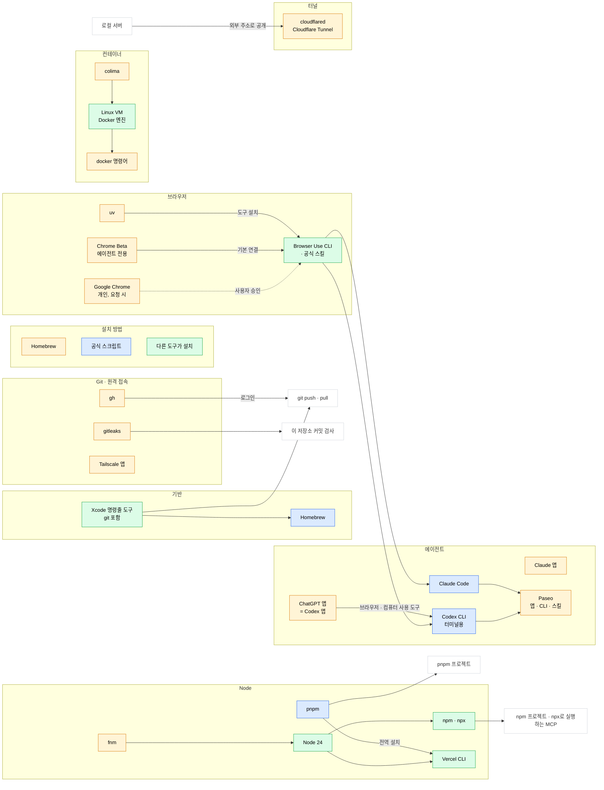

# 도구와 공식 문서

이 저장소가 설치하는 도구와 그 관계, 도구마다 공식 문서 링크와 설치 방법을 고른 이유를 적는다. 자동 설치 명령은 Brewfile과 `scripts/`에서 관리한다.

## 전체 구조

화살표 A → B는 B가 A를 쓴다는 뜻이다. 색은 설치 방법이다. 모든 기기에 같은 것을 설치한다.

## 설치 방법을 고르는 기준

1. **공식 문서에 있는 방법만 쓴다.** 비공식 경로로 설치한 것은 중복되거나 흔적이 남기 쉽다.
2. 그중 **스스로 업데이트되는 방법을 우선한다.** Claude Code, Codex CLI가 여기에 해당한다(공식 설치 스크립트).
3. 업데이트 방식에 차이가 없으면 **Homebrew**를 쓴다. 목록 하나(Brewfile)로 재현되고 지우기도 쉽다. 앱도 Homebrew cask로 설치한다. cask는 개발사가 올린 같은 파일을 받아 설치만 자동으로 해 주고, 설치 후에는 앱이 스스로 업데이트한다.
4. **Node는 버전 관리 도구(fnm)로** 설치한다. 프로젝트마다 다른 버전을 쓰기 때문이다.

## 갱신하는 법

- 설치가 실패하거나 설치 방법이 바뀐 것 같으면 먼저 공식 문서를 본다. 그다음 Brewfile·스크립트를 고치고, 아래 표에서 그 줄의 확인일을 갱신한다.
- 새 기기를 들이기 전에 표 전체 링크를 한 번 확인한다.

## 기본

| 도구 | 우리 설치 방법 | 공식 문서 | 비고 | 확인일 |
|---|---|---|---|---|
| Xcode 명령줄 도구 | `xcode` 단계 | [Apple](https://developer.apple.com/documentation/xcode/installing-the-command-line-tools/) | git이 여기 들어 있다 | 2026-10-07 |
| Homebrew | `homebrew` 단계 (공식 설치 스크립트) | [docs.brew.sh](https://docs.brew.sh/Installation) | 설치 후 `brew shellenv`를 셸 설정에 넣어야 한다 → [`.zprofile`](home/zsh/.zprofile) | 2026-10-07 |
| Brewfile | `brew bundle` | [docs.brew.sh](https://docs.brew.sh/Brew-Bundle-and-Brewfile) | | 2026-10-07 |
| gh | `Brewfile` | [GitHub](https://github.com/cli/cli/blob/trunk/docs/install_macos.md) | Homebrew가 공식 권장 방법 | 2026-10-07 |
| gitleaks | `Brewfile` | [GitHub](https://github.com/gitleaks/gitleaks) | 이 저장소의 커밋 전 비밀값 검사용. 기능 추가는 끝났고 보안 패치만 나온다 (후속 도구는 Betterleaks) | 2026-10-07 |
| Tailscale 앱 | `cask "tailscale-app"` | [tailscale.com](https://tailscale.com/docs/install/mac) | Standalone 버전, 공식 권장. `tailscale` 명령어는 쓰지 않는다 (필요하면 앱 설정 → [CLI integration](https://tailscale.com/docs/reference/tailscale-cli)) | 2026-10-07 |

## Node

| 도구 | 우리 설치 방법 | 공식 문서 | 비고 | 확인일 |
|---|---|---|---|---|
| fnm | `Brewfile` | [GitHub](https://github.com/Schniz/fnm) | Homebrew가 공식 방법 중 하나 | 2026-10-07 |
| Node | fnm (`runtimes` 단계) | [nodejs.org](https://nodejs.org/en/download) | fnm이 공식 권장 방법 중 하나 | 2026-10-07 |
| pnpm | `runtimes` 단계 (공식 설치 스크립트) | [pnpm.io](https://pnpm.io/installation) | Node와 따로 설치되는 단독 실행 파일. 프로젝트의 `packageManager`에 고정된 버전은 자동으로 받아 쓴다([`pmOnFail`](https://pnpm.io/settings/cli) 기본값). 업데이트는 `pnpm self-update` | 2026-10-07 |
| Vercel CLI | `runtimes` 단계 (pnpm 전역 설치) | [vercel.com](https://vercel.com/docs/cli) | 공식 문서의 pnpm 방법. `vercel upgrade --enable-auto`로 자동 업데이트를 켠다 ([문서](https://vercel.com/docs/cli/upgrade)). Homebrew `vercel-cli`는 공식 문서에 없다 | 2026-10-07 |

## 컨테이너

| 도구 | 우리 설치 방법 | 공식 문서 | 비고 | 확인일 |
|---|---|---|---|---|
| colima | `Brewfile` | [GitHub](https://github.com/abiosoft/colima) | Homebrew가 첫 번째 방법 | 2026-10-07 |
| docker 명령어 | `Brewfile` | [colima](https://github.com/abiosoft/colima), [Homebrew](https://formulae.brew.sh/formula/docker) | colima 문서가 `brew install docker`를 안내한다. Docker Desktop 없이 명령어만 설치 | 2026-10-07 |

## 에이전트

| 도구 | 우리 설치 방법 | 공식 문서 | 비고 | 확인일 |
|---|---|---|---|---|
| Claude Code | `agents` 단계 (공식 설치 스크립트) | [code.claude.com](https://code.claude.com/docs/en/setup) | 공식 권장. 스스로 업데이트된다 | 2026-10-07 |
| Claude 앱 | `cask "claude"` | [claude.com](https://claude.com/download) | | 2026-10-07 |
| Codex CLI | `agents` 단계 (공식 설치 스크립트) | [learn.chatgpt.com](https://learn.chatgpt.com/docs/codex/cli) | 공식 기본 방법. `~/.local/bin`에 설치되고 스스로 업데이트된다 | 2026-10-07 |
| ChatGPT 앱 | `cask "chatgpt"` | [learn.chatgpt.com](https://learn.chatgpt.com/docs/app) | 2026-07부터 Codex 앱이 ChatGPT 앱에 합쳐졌다 ([changelog](https://learn.chatgpt.com/docs/changelog)). 업데이트가 잦아 Homebrew가 OpenAI보다 먼저 새 버전으로 올라가 설치가 실패할 때가 있다. 하루쯤 뒤 다시 하거나 공식 페이지에서 받는다 | 2026-10-07 |
| Paseo | `cask "paseo"` | [paseo.sh/download](https://paseo.sh/download), [paseo.sh/docs](https://paseo.sh/docs) | cask가 앱 안의 `paseo` CLI도 연결한다 | 2026-10-07 |

ripgrep은 따로 설치하지 않는다. Claude Code는 `rg`가 없으면 내장 ripgrep으로 대신하고, Codex CLI는 ripgrep을 함께 설치한다.

## 브라우저

| 도구 | 우리 설치 방법 | 공식 문서 | 비고 | 확인일 |
|---|---|---|---|---|
| Google Chrome | `cask "google-chrome"` | [Chrome](https://www.google.com/chrome/), [승인형 직접 연결](https://developer.chrome.com/docs/devtools/agents/use-cases/auto-connect) | 개인용. 사용자가 요청할 때만 에이전트가 연결하며 연결마다 사용자 승인. 종료 상태에서 디버깅 설정을 병합 | 2026-10-18 |
| Google Chrome Beta | `cask "google-chrome@beta"` | [Chrome Beta](https://www.google.com/chrome/beta/) | 에이전트 전용. 개인 Chrome과 앱이 달라야 Dock·링크 열기가 섞이지 않는다. 전용 프로필·고정 포트(9333)로 띄워 승인 없이 연결 | 2026-10-19 |
| uv | `brew "uv"` | [astral.sh](https://docs.astral.sh/uv/getting-started/installation/) | Homebrew가 공식 방법 중 하나. Browser Use를 Node와 독립된 도구 환경에 설치한다 | 2026-10-19 |
| Browser Use | `browser` 단계 (`uv tool install --python 3.12 browser-use`) | [공식 CLI](https://docs.browser-use.com/open-source/browser-use-cli) | 브라우저 작업 기본 도구. 공식 스킬을 Codex·Claude에 배치 → [운영 지침](agents/browser.md) | 2026-10-19 |

## 터널

| 도구 | 우리 설치 방법 | 공식 문서 | 비고 | 확인일 |
|---|---|---|---|---|
| cloudflared | `Brewfile` | [Cloudflare](https://developers.cloudflare.com/cloudflare-one/networks/connectors/cloudflare-tunnel/downloads/) | Cloudflare Tunnel 연결 프로그램. Homebrew가 첫 번째 공식 방법 | 2026-10-07 |
